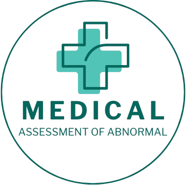
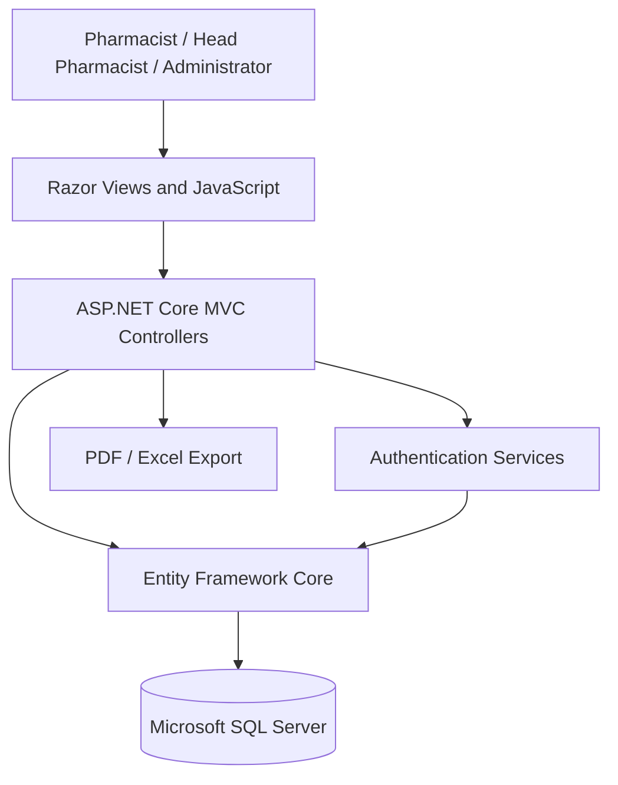
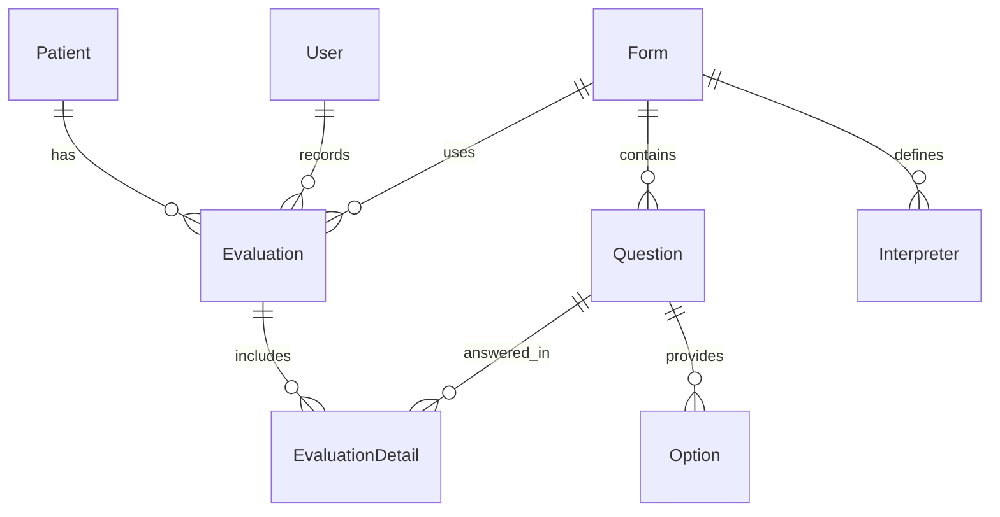

<div align="center">



# Abnormal Movement Assessment System

**A role-based patient management and abnormal movement assessment web application.**

Academic senior project built using ASP.NET Core MVC, C#, Entity Framework Core, and Microsoft SQL Server.

[](https://dotnet.microsoft.com/)
[](https://learn.microsoft.com/aspnet/core/)
[](https://www.microsoft.com/sql-server)

</div>

## Overview

The **Abnormal Movement Assessment System** supports pharmacists in managing patient records, performing structured abnormal movement assessments, reviewing historical results, and generating assessment reports. It provides role-specific interfaces for pharmacists, head pharmacists, and administrators.

> **Scope:** This is an academic software project, not a clinically validated diagnostic tool or production-ready electronic health record system.

## Features

### Patient management
- Register, search, view, and update patient records using a Hospital Number (HN).
- Store relevant patient details, treatment information, and geographical address data.
- Check for potential duplicate patient records.

### Structured assessments
- Complete assessments and save individual question responses and scores.
- Associate evaluations with patients, forms, and evaluating users.
- Review evaluation history and detailed results.
- Forms referenced by the system include **Mod-AIMS** (Modified Abnormal Involuntary Movement Scale), **Mod-SAS** (Modified Simpson–Angus Scale), and **Mod-BARS** (Modified Barnes Akathisia Rating Scale).

### Configurable assessment forms
- Create and edit questionnaires, answer options, and scoring rules.
- Configure score aggregation methods including **Sum**, **Max**, and **Min**.
- Define score ranges and interpretations.
- Manage forms while considering their existing assessment records.

### Reports and dashboards
- Export individual evaluations to **PDF** using assessment-specific templates.
- Produce aggregate assessment reports in **PDF** and **Excel** formats.
- Review assessment summaries, score distributions, and date-based reporting views.

> Some dashboard code includes illustrative or hard-coded data in addition to database-backed endpoints; not every chart represents verified live metrics.

### Accounts and administration
- Cookie-based authentication with claims and role-dependent navigation.
- Manage user accounts, roles, and account status.
- Maintain title and treatment reference records.
- View login activity logs.

## User Roles

| Role | Main responsibilities |
| --- | --- |
| **Pharmacist** | Patient management, assessment forms, evaluations, and individual PDF exports. |
| **Head Pharmacist** | Review patient assessments, dashboard data, and PDF/Excel reports. |
| **Administrator** | Manage user accounts and reference data, and review login logs. |

The application implements ASP.NET Core authentication and role authorization. Authorization coverage should be reviewed before real-world deployment.

## Technology Stack

| Layer | Technologies |
| --- | --- |
| Backend | C#, ASP.NET Core MVC, .NET 9 |
| Frontend | Razor Views, HTML, CSS, JavaScript, Bootstrap, jQuery |
| Database | Microsoft SQL Server |
| ORM | Entity Framework Core 9 |
| Authentication | ASP.NET Core Cookie Authentication, Claims |
| PDF reports | iText 9, pdfHTML |
| Excel reports | ClosedXML |
| UI and utilities | Chart.js, Font Awesome, SweetAlert2, Razor.Templating.Core |

See [Project.csproj](Project/Project.csproj) for package dependencies.

## Architecture



### Main Data Relationships



## Project Structure

```text
SeniorProject/
├── Project.sln
└── Project/
    ├── Controllers/
    │   ├── AdminController.cs
    │   ├── HomeController.cs
    │   ├── HPController.cs
    │   └── PharmaController.cs
    ├── Data/
    │   └── ApplicationDbContext.cs
    ├── Models/
    │   └── Entity/
    ├── Services/
    │   ├── AuthService.cs
    │   └── PasswordService.cs
    ├── Views/
    │   ├── Admin/
    │   ├── Home/
    │   ├── HP/
    │   ├── Pharma/
    │   └── Shared/
    ├── wwwroot/
    │   ├── css/
    │   ├── img/
    │   ├── js/
    │   └── pdf/
    ├── Program.cs
    └── Project.csproj
```

## Getting Started

### Requirements
- [.NET 9 SDK](https://dotnet.microsoft.com/download/dotnet/9.0)
- Microsoft SQL Server
- Visual Studio with ASP.NET development tooling, or another .NET-compatible editor
- A compatible SQL Server database schema with required reference data

**Database limitation:** The repository does not currently include checked-in SQL initialization scripts or EF Core migration files. It **cannot be run from a fresh clone alone** without provisioning a compatible database separately. Demo credentials are not provided.

### 1. Clone

```bash
git clone https://github.com/SnowvyTH/SeniorProject.git
cd SeniorProject
```

### 2. Restore dependencies

```bash
dotnet restore Project.sln
```

### 3. Configure the database

The application reads `ConnectionStrings:DefaultConnection`. Set it locally without committing credentials, for example in **PowerShell**:

```powershell
$env:ConnectionStrings__DefaultConnection = "Server=localhost;Database=YOUR_DATABASE;Trusted_Connection=True;TrustServerCertificate=True;"
```

Adjust the server, database, and authentication options for your SQL Server setup. Populate the required schema and seed/reference records before signing in.

### 4. Build and run

```bash
dotnet build Project.sln
dotnet run --project Project/Project.csproj --launch-profile http
```

Open **http://localhost:5180**, the HTTP address specified in `Project/Properties/launchSettings.json`.

## PDF Templates

PDF templates in the repository are used for individual evaluation exports:
- [Mod-AIMS](Project/wwwroot/pdf/modaims.pdf)
- [Mod-SAS](Project/wwwroot/pdf/modsas.pdf)
- [Mod-BARS](Project/wwwroot/pdf/modbar.pdf)

## Screenshots

Screenshots of the patient list, assessment workflow, and reporting pages can be added here. **Use synthetic or fully anonymized patient data only** in public images.

## Engineering Highlights

- Designed a multi-role application with ASP.NET Core MVC and role authorization.
- Modeled patient, form, questionnaire, and evaluation relationships with Entity Framework Core.
- Implemented structured assessment workflows and configurable scoring.
- Built PDF/Excel exports for individual and aggregate results.
- Organized the project into controllers, data models, Razor views, and supporting services.

## Author

**[SnowvyTH](https://github.com/SnowvyTH)** — Academic senior project.
